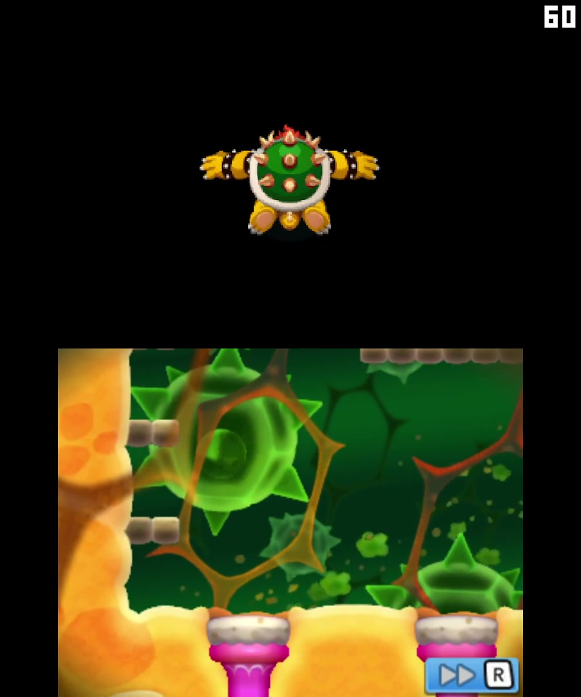

# 60 FPS Patch - Mario & Luigi: Bowser's Inside Story + Bowser Jr.'s Journey (3DS)

**Double your framerate from 30 FPS to 60 FPS.** The recommended build is an IPS patch with cutscene skip, stock R fast-forward at 60fps, and a hold-L-for-30fps toggle.

> **Latest: [v1.2.4](https://github.com/struktured-labs/bis/releases/tag/v1.2.4).**
> Tested on a real New 3DS XL (USA game 1.0), in battle and out: cutscene skip, counter on/off, and the L 30fps hold
> ([video](https://github.com/struktured-labs/bis/releases/download/v1.2.4/bis_v1.2.4_real_3ds_game1.0.mp4)).
> Game 1.2 is verified in stock Azahar only, and has not been run on real hardware yet.
>
> **Pick the patch that matches your game version.** Title screen shows "Ver. 1.2" (FBI lists the update title) = game 1.2; no label (FBI shows Version 0 and no update title) = game 1.0.
> **The wrong one crashes at boot.** Download [`bis_60fps_v1.2.4_usa.zip`](https://github.com/struktured-labs/bis/releases/tag/v1.2.4) from the release and read its README.txt.



| | |
|---|---|
| **Game** | Mario & Luigi: Bowser's Inside Story + Bowser Jr.'s Journey |
| **Region** | USA |
| **Title ID** | 00040000001D1400 |
| **Patch Size** | 2040 bytes (game 1.0) / 2058 bytes (game 1.2) |
| **Format** | IPS (code.bin patch) |

---

## What This Does

The game internally supports both 30 FPS and 60 FPS modes, controlled by a single byte in memory. By default, the game locks itself to 30 FPS. This patch modifies two instructions in the game code so the framerate check always returns "60 FPS mode," resulting in smooth 60 FPS gameplay.

Unlike cheat codes that continuously overwrite memory every 50ms, this patch modifies the game code itself -- it's cleaner, more reliable, and works without any cheat engine.

---

## Installation

**Use the files in `bis_60fps_v1.2.4_usa.zip` from the [v1.2.4 release](https://github.com/struktured-labs/bis/releases/tag/v1.2.4).** Check your game version first: "Ver. 1.2" on the title screen, or FBI listing the update title, means game 1.2 (`game_v1.2/60fps_v12_skip.ips`). No label, or FBI showing Version 0 and no update title, means game 1.0 (`game_v1.0/60fps_v10_skip.ips`). **The wrong file crashes at boot.**

### Luma3DS (Real 3DS / 2DS Hardware)

1. Copy the IPS for your game version into this folder and **rename it to `code.ips`**:
   ```
   SD:/luma/titles/00040000001D1400/code.ips
   ```
   Use the base title ID (`00040000001D1400`), even if the 1.2 update is
   installed. Do not use the update title `0004000E001D1400` — Luma will
   not apply the patch from that folder.
   No SD swap needed: you can send the file over Wi-Fi with an FTP homebrew
   app such as ftpd.
2. Hold SELECT while powering on, turn on "Enable game patching", and save.
3. Launch the game. It runs at 60fps; hold L for 30fps. Tap START in a cutscene to skip, or hold START to speed it up. L+SELECT toggles the FPS counter (off by default). R is the game's own fast-forward, now at 60fps.

### Azahar / Lime3DS Emulator

1. Copy the IPS for your game version (see above) into the mods folder:

   **Linux:**
   ```
   ~/.local/share/azahar-emu/load/mods/00040000001D1400/exefs/code.ips
   ```
   **Windows:**
   ```
   %APPDATA%/azahar-emu/load/mods/00040000001D1400/exefs/code.ips
   ```
   **macOS:**
   ```
   ~/Library/Application Support/azahar-emu/load/mods/00040000001D1400/exefs/code.ips
   ```
3. Launch the game -- the patch applies automatically

### Citra Emulator

1. Copy the IPS for your game version to:

   **Linux:**
   ```
   ~/.local/share/citra-emu/load/mods/00040000001D1400/exefs/code.ips
   ```
   **Windows:**
   ```
   %APPDATA%/Citra/load/mods/00040000001D1400/exefs/code.ips
   ```
3. Launch the game -- the patch applies automatically

---

## Compatibility

| Platform | Status |
|----------|--------|
| Real 3DS (Luma3DS), v1.2.4, game 1.0 | Tested on a New 3DS XL, in battle and out: cutscene skip, counter on/off, and the L 30fps hold (2026-11-27) |
| Real 3DS (Luma3DS), v1.2.4, game 1.2 | Not yet tested on hardware (emulator-verified only) |
| Azahar / Lime3DS (Vulkan) | Tested |
| Azahar / Lime3DS (OpenGL) | Should work |
| Citra | Should work |
| Old 3DS / 2DS | May have performance issues at 60 FPS |

**Region:** USA (00040000001D1400). Other regions have different Title IDs and may need different patch offsets.

---

## Uninstalling

Delete the `code.ips` file from the mod folder and restart the game. No permanent changes are made to your game files.

---

## How It Works

The game stores a framerate control byte at offset `+0x3D` in a heap-allocated struct. A value of `0x01` means 30 FPS; `0x00` means 60 FPS. Two locations in `code.bin` read this byte every frame to decide the framerate.

This patch replaces both `LDRB` (Load Register Byte) instructions with `MOV #0`, so the game always sees "60 FPS mode":

| Offset | Original | Patched | Instruction Change |
|--------|----------|---------|-------------------|
| `0x03E918` | `E5D4103D` | `E3A01000` | `LDRB R1,[R4,#0x3D]` -> `MOV R1,#0` |
| `0x180A84` | `E5D4003D` | `E3A00000` | `LDRB R0,[R4,#0x3D]` -> `MOV R0,#0` |

Offsets are into the decompressed `code.bin`.

### Discovery Process

This patch was found through dynamic analysis by instrumenting the Lime3DS emulator:

1. **SVC instrumentation** revealed the game uses VBlank synchronization for frame timing
2. **Cheat engine instrumentation** showed the existing 60fps cheat only writes a single byte (`0x320DA3AD = 0x00`)
3. **Memory watchpoints** (with dynarmic fastmem disabled) identified the two game code locations that read the FPS control byte every frame
4. **Disassembly** of those locations revealed `LDRB` instructions loading from struct offset `+0x3D`
5. Replacing both with `MOV #0` forces 60 FPS permanently

36+ test ROMs were built and tested during the investigation. Full technical writeup: [FINAL_ANALYSIS.md](FINAL_ANALYSIS.md)

---

## Alternative: Cheat Code

If you prefer to use a cheat code instead (requires CTRPF or Luma3DS cheat engine):

**File:** `SD:/cheats/00040000001D1400.txt`

```
[60FPS v1.2]
D3000000 30000000
50000074 01000101
20000075 00000000
D0000000 00000000
520DA3AC 01000101
220DA3AD 00000000
D0000000 00000000
50000064 01000101
20000065 01000000
D0000000 00000000
50000044 01000101
20000045 00000000
D0000000 00000000
D2000000 00000000
```

Credit: @Shay from [60FPS-AR-CHEATS-3DS](https://github.com/Reshiban/60FPS-AR-CHEATS-3DS)

The IPS patch is recommended over the cheat code because it patches the game code directly rather than continuously overwriting memory at runtime.

---

## For Patch Authors: Real Hardware Rule

Never hardcode memory addresses or rely on behavior that only holds in an
emulator. Read state the way the game or the OS does. v1.2.1 read the R
button from `0x1000201C`, an address that only exists in Azahar/Citra, and
crashed at boot on real 3DS hardware. v1.2.2 reads it through the game's
own HID object (`*(*(0x42A6C0 + 4) + 0x1C)`). v1.2.2 then put its code cave
over a live boot routine that waits for a worker thread, a race Azahar's
scheduling hid; v1.2.3 moves the cave into unused padding at the end of
`.text` (vaddr `0x389F00`). See [docs/REAL_HW_AUDIT_2026-11-24.md](docs/REAL_HW_AUDIT_2026-11-24.md). See
[docs/REAL_HARDWARE_RULES.md](docs/REAL_HARDWARE_RULES.md) and
[CONTRIBUTING.md](CONTRIBUTING.md).

---

## Credits

- **Patch by:** struktured + [Claude](https://claude.ai)
- **Original cheat research:** @Shay ([60FPS-AR-CHEATS-3DS](https://github.com/Reshiban/60FPS-AR-CHEATS-3DS))
- **Emulator:** [Azahar/Lime3DS](https://azahar-emu.org/) (used for dynamic analysis)

## License

MIT
