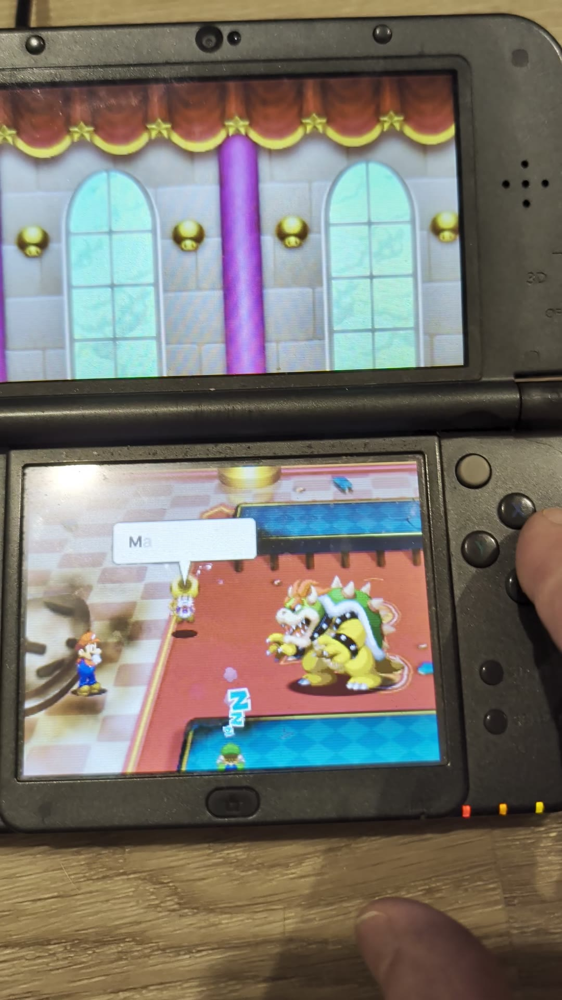

# Real 3DS hardware test: v1.2.3 (2026-11-24)

Video (38 s, phone camera): https://github.com/struktured-labs/bis/releases/download/v1.2.3/bis_v1.2.3_real_3ds_game1.0.mp4

## Setup

- Console: real 3DS with Luma3DS, "Enable game patching" on.
- Game: Mario & Luigi: Bowser's Inside Story + Bowser Jr.'s Journey, USA,
  **game 1.0** (no update installed; FBI shows version 0.0.0).
- Patch: `game_v1.0/60fps_v10_full_r.ips` from v1.2.3, copied over FTP (ftpd) to
  `SD:/luma/titles/00040000001D1400/code.ips`.
  133 bytes, sha256 `7628c2a30beee2a324b8feb7399f812a09b3189fd4d1cb13ec05396a6173c5d2`
  (read back after the transfer; the only file in that folder).

## Result

- Boots past the title screen and plays with **no crash, freeze or glitch**.
- Video: 0:00-0:19 opening throne-room cutscene (field), 0:19-0:24 battle
  transition, 0:24-0:38 Mario vs Bowser tutorial battle.

## What this does and does not show

- Shown on hardware: the v1.2.3 game 1.0 patch boots and runs. This covers the
  v1.2.1 crash (emulator-only HID address) and the v1.2.2 boot-sync cave issue.
- **Not** shown on hardware: the frame rate itself. The phone recorded at
  30 fps, so the video cannot show 60 vs 30, and the tester could not tell by
  eye. The 60fps / hold-R-for-30fps toggle is verified in stock Azahar 2126.2
  (emulator FPS counter; see [REAL_HW_AUDIT_2026-11-24.md](REAL_HW_AUDIT_2026-11-24.md)).
- Game 1.2 (`game_v1.2/60fps_v12_full_r.ips`) has not been run on real hardware.

## Wrong-version crash (first attempt)

The first attempt that night crashed at boot (Luma exception screen, a data
abort writing to address 8). Cause: the **game 1.2** patch had been copied onto
a **game 1.0** install. The same crash reproduces in Azahar with that mismatch;
the game 1.0 patch does not touch that code. Not a bug in the patch, but the
reason every README now says to check the title screen first.

## Observation: R and the game's own fast-forward

R is also the game's built-in "hold to fast-forward cutscenes" button (the
`>> R` icon on the bottom screen). While R was held in the video (about
0:02-0:08) the cutscene did not fast-forward: with the R-toggle patches, R
selects 30fps instead. This is how the R-toggle patches have worked since
v1.2.1, not new in v1.2.3. Listed under Known Issues.
